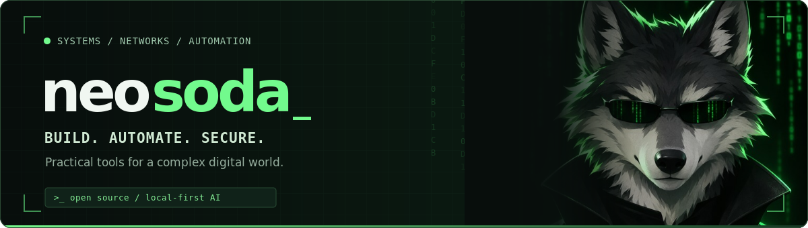
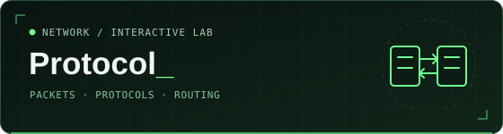
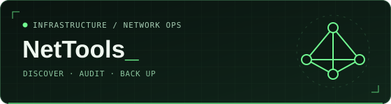
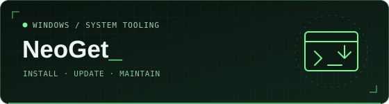
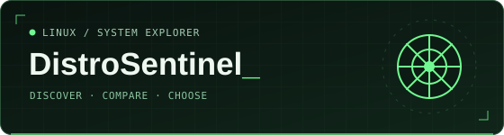
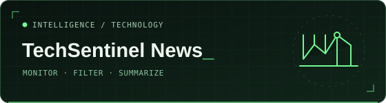
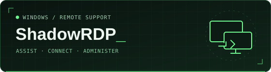

<div align="center">
  
  <br /><br />
  <a href="https://blog.techsentinel.fr/">TechSentinel blog</a> &nbsp; / &nbsp;
  <a href="https://github.com/neosoda?tab=repositories">All repositories</a> &nbsp; / &nbsp;
  <a href="https://hub.xerj.org/contributors/neosoda">XERJ contributor</a>
</div>

## `01 / WHOAMI`

I'm Neo, a systems & network administrator based in France, a self-hoster and a builder by nature.

I build practical tools for infrastructure, cybersecurity, Windows, Linux and local-first AI. Real problems, clean solutions, no unnecessary complexity.

## `02 / SELECTED WORK`

<table>
  <tr>
    <td width="50%" valign="top">
      <a href="https://github.com/neosoda/agent-commons"></a>
      <p><strong>A local control center for AI agent skills and MCP servers.</strong><br /><sub>Node.js · Skills · MCP</sub></p>
      <a href="https://github.com/neosoda/agent-commons">Source &amp; docs</a>
    </td>
    <td width="50%" valign="top">
      <a href="https://github.com/neosoda/Protocol"></a>
      <p><strong>Understand network protocols, packet by packet.</strong><br /><sub>Interactive lessons · TCP/IP · DNS · Routing</sub></p>
      <a href="https://protocol.techsentinel.fr">Live lab</a> · <a href="https://github.com/neosoda/Protocol">Source</a>
    </td>
  </tr>
  <tr>
    <td width="50%" valign="top">
      <a href="https://github.com/neosoda/NetTools"></a>
      <p><strong>Discover, inventory, back up and audit network devices.</strong><br /><sub>Go · Wails · React · SNMP · SSH</sub></p>
      <a href="https://github.com/neosoda/NetTools">Source &amp; docs</a>
    </td>
    <td width="50%" valign="top">
      <a href="https://github.com/neosoda/NeoGet"></a>
      <p><strong>Windows application management, updates and system maintenance.</strong><br /><sub>Tauri · Rust · React · TypeScript</sub></p>
      <a href="https://github.com/neosoda/NeoGet">Source &amp; docs</a>
    </td>
  </tr>
  <tr>
    <td width="50%" valign="top">
      <a href="https://github.com/neosoda/DistroSentinel"></a>
      <p><strong>Explore and compare Linux and BSD distributions.</strong><br /><sub>TypeScript · Vite · Docker</sub></p>
      <a href="https://distro.techsentinel.fr/">Live explorer</a> · <a href="https://github.com/neosoda/DistroSentinel">Source</a>
    </td>
    <td width="50%" valign="top">
      <a href="https://github.com/neosoda/news"></a>
      <p><strong>Automated technology and security monitoring with AI summaries.</strong><br /><sub>Node.js · React · RSS · LLM routing</sub></p>
      <a href="https://github.com/neosoda/news">Source &amp; docs</a>
    </td>
  </tr>
  <tr>
    <td width="50%" valign="top">
      <a href="https://github.com/neosoda/GenSentinel"></a>
      <p><strong>Generate passwords, tokens and secrets directly in your browser.</strong><br /><sub>Next.js · TypeScript · Web Crypto</sub></p>
      <a href="https://github.com/neosoda/GenSentinel">Source &amp; docs</a>
    </td>
    <td width="50%" valign="top">
      <a href="https://github.com/neosoda/ShadowRDP"></a>
      <p><strong>Remote assistance and RDP Shadow administration toolkit.</strong><br /><sub>PowerShell · Active Directory · GPO</sub></p>
      <a href="https://github.com/neosoda/ShadowRDP">Source &amp; docs</a>
    </td>
  </tr>
</table>

### `+ / EXPLORE MORE`

| Project | What it does | Explore |
| :--- | :--- | :--- |
| **Chocolatey Packager** | Build and validate Chocolatey packages from MSI and EXE installers using a GUI. | [Source & docs](https://github.com/neosoda/ChocolateyPackager) · [Releases](https://github.com/neosoda/ChocolateyPackager/releases) |
| **TechSentinel Toolbox** | Self-hostable browser tools for PDF, images, text and data, adapted from OmniTools. | [Live](https://tools.techsentinel.fr) · [Source](https://github.com/neosoda/Tools) |
| **Networking Toolbox** | CIDR, DNS, IP tools and network diagnostics in the browser. | [Live](https://nettools.techsentinel.fr) · [Source](https://github.com/neosoda/networking-toolbox) |

## `03 / SYSTEM STACK`

| Domain | Tools & interests |
| :--- | :--- |
| Infrastructure | Linux · Windows Server · Docker · Virtualization · Zabbix · Cloudflare |
| Engineering | TypeScript · Go · Rust · Python · PowerShell · React |
| Data & services | PostgreSQL · APIs · Self-hosting |
| AI | Local LLMs · AI agents · MCP · RAG · Automation |
| Security | Network security · Hardening · Secure-by-design tooling |

## `04 / OPERATING PRINCIPLES`

```text
neo@matrix:~$ cat principles.conf

  reliability   > hype
  simplicity    > complexity
  automation    > repetition
  security      = by design
  maintainable  > clever
  shipping      > overthinking
  curiosity     = always on
```

<div align="center">
  <br />
  <strong>There is no spoon. But there is always a better way.</strong>
  <br /><br />
  If you find a project useful, star it or open an issue with an idea.
  <br /><br />
  <sub><a href="https://github.com/neosoda?tab=repositories">Explore my work</a> · <a href="https://blog.techsentinel.fr/">Read TechSentinel</a> · <a href="https://hub.xerj.org/contributors/neosoda">XERJ contributor</a></sub>
</div>
