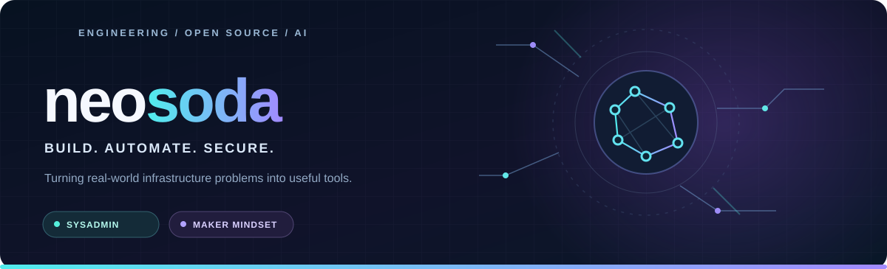
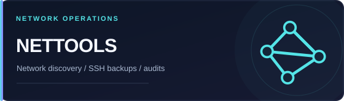
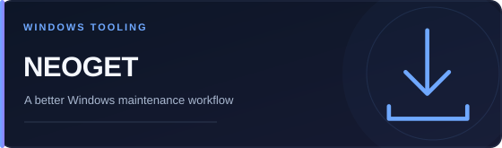
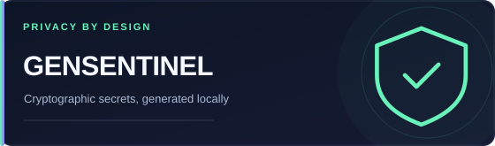
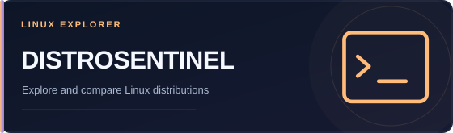
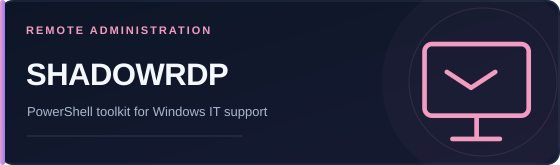

<div align="center">
  

  <br /><br />

  <a href="https://hub.xerj.org/contributors/neosoda"></a>
  &nbsp;
  <a href="https://blog.techsentinel.fr/"></a>
  &nbsp;
  <a href="https://github.com/neosoda?tab=repositories"></a>

  <br /><br />

  **Hey, I'm Neo.** 👋

  Systems & network administrator by day. Builder, self-hoster and automation enthusiast by nature.

  I build practical tools for **infrastructure, cybersecurity, Windows, Linux and local-first AI**.
  Real problems, clean solutions, no unnecessary complexity.
</div>

<br />

## `01 / SELECTED WORK`

<div align="center">
  <sub>Tools I build to make technology more useful, reliable and accessible.</sub>
</div>

<br />

<table>
  <tr>
    <td width="50%" valign="top">
      <a href="https://github.com/neosoda/NetTools"></a>
      <p><strong>Discover, inventory, back up and audit network devices.</strong><br />
      <sub>Go · Wails · React · SNMP · SSH</sub></p>
    </td>
    <td width="50%" valign="top">
      <a href="https://github.com/neosoda/NeoGet"></a>
      <p><strong>WinGet package management, diagnostics and Windows maintenance.</strong><br />
      <sub>Tauri · Rust · React · TypeScript</sub></p>
    </td>
  </tr>
  <tr>
    <td width="50%" valign="top">
      <a href="https://github.com/neosoda/news"></a>
      <p><strong>Automated tech and security monitoring with AI summaries.</strong><br />
      <sub>Node.js · React · RSS · LLM routing</sub></p>
    </td>
    <td width="50%" valign="top">
      <a href="https://github.com/neosoda/GenSentinel"></a>
      <p><strong>Generate passwords, tokens and secrets directly in the browser.</strong><br />
      <sub>Next.js · TypeScript · Web Crypto</sub></p>
    </td>
  </tr>
  <tr>
    <td width="50%" valign="top">
      <a href="https://github.com/neosoda/DistroSentinel"></a>
      <p><strong>Discover and compare Linux distributions with useful filters.</strong><br />
      <sub>TypeScript · Vite · Docker</sub></p>
    </td>
    <td width="50%" valign="top">
      <a href="https://github.com/neosoda/ShadowRDP"></a>
      <p><strong>Remote assistance and RDP Shadow administration toolkit.</strong><br />
      <sub>PowerShell · Active Directory · GPO</sub></p>
    </td>
  </tr>
</table>

<br />

## `02 / MY TOOLBOX`

<p><strong>Build & code</strong></p>


<p><strong>Infrastructure & operations</strong></p>


<p><strong>Exploring every day</strong></p>

`Local AI` · `AI agents` · `MCP` · `RAG` · `Self-hosting` · `Automation` · `Network security`

<br />

## `03 / HOW I THINK`

```text
$ whoami
  sysadmin / builder / curious human

$ mission
  make complex systems simpler, safer and easier to operate

$ principles
  practical > fashionable
  maintainable > clever
  automation > repetition
  shipping > overthinking
```

<br />

<div align="center">

### Let's build things that actually work.

If you find a project useful, drop it a ⭐ — or open an issue with an idea.

<a href="https://github.com/neosoda?tab=repositories"></a>
&nbsp;
<a href="https://blog.techsentinel.fr/"></a>

<br /><br />

<sub>Made with curiosity, caffeine & a healthy obsession with making things work. ☕</sub>

</div>
